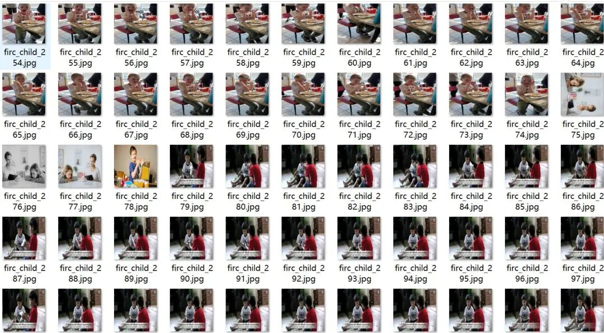
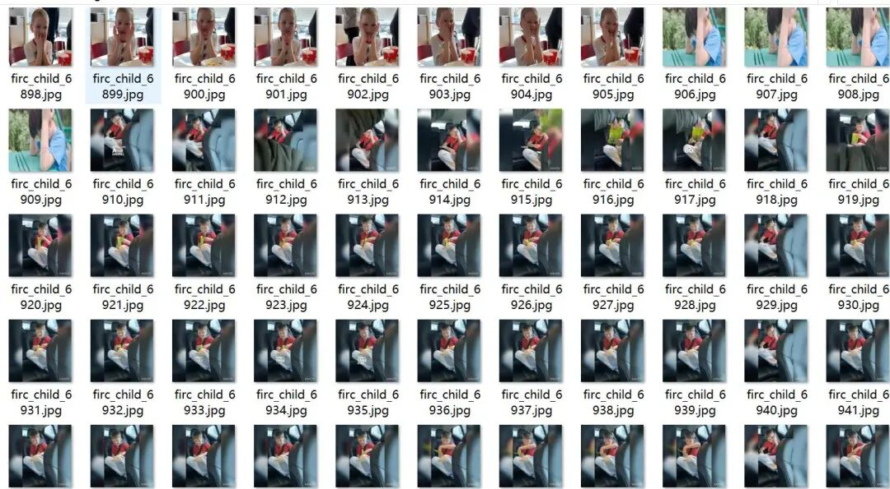
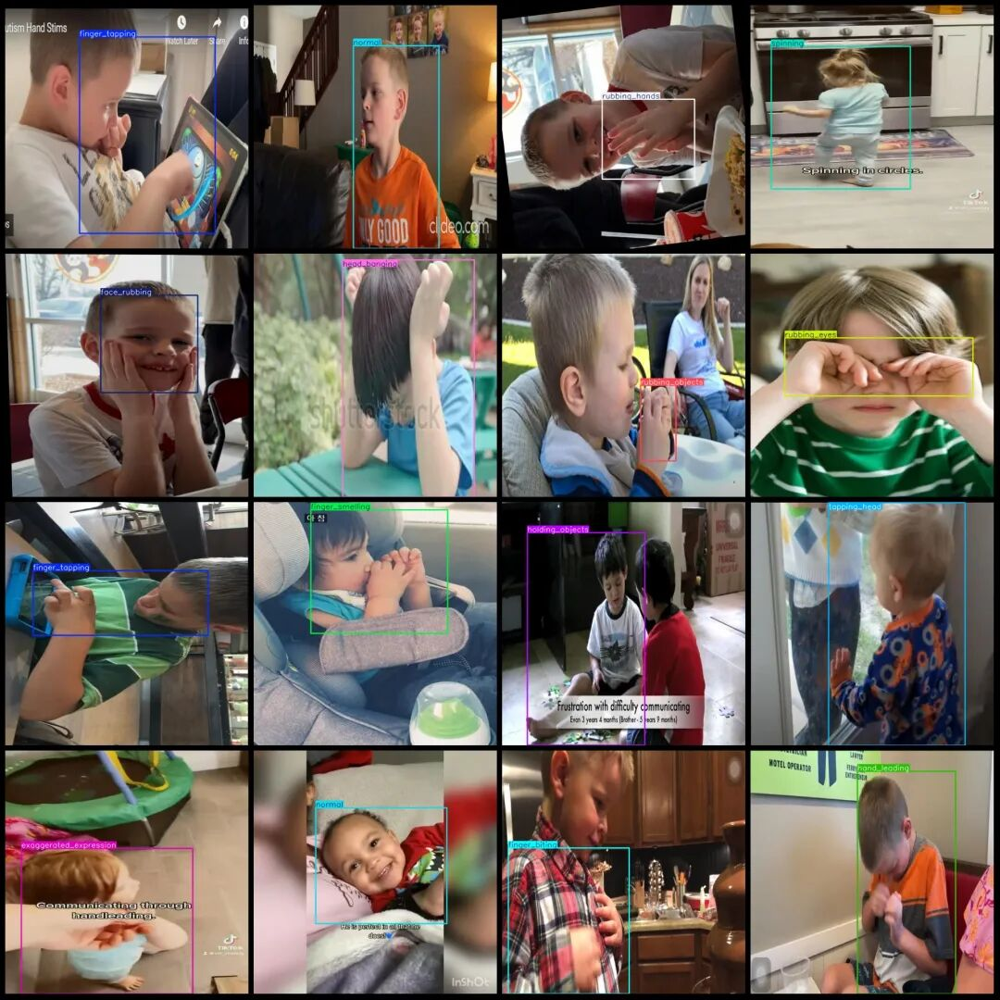

# Intelligent Healthcare - Autism Spectrum Disorder Children Behavioral Detection Dataset VOC+YOLO Format with 7295 Images and 34 Categories

The dataset contains many enhanced images and also a series of consecutive video frames. Please refer to the image preview for details.

Dataset format: Pascal VOC format + YOLO format (txt file without split path, only contains jpg images and corresponding VOC format xml files and yolo format txt files)

Number of images (number of jpg files): 7295

Number of annotations (number of xml files): 7295

Number of annotations (number of txt files): 7295

Label count: 34

Label category name(NoteyoloThe format category order does not correspond to this, but instead...labelsFolderclasses.txtPrecise):["Lack_social_skill","Stimming","aligning_objects","avoid_eye_contact","awkward_posture","clapping","closing_eyes","continuous_moving","exaggerated_expression","face_rubbing","finger_biting","finger_flapping","finger_smelling","finger_tapping","hand_flapping","hand_leading","head_banging","holding_objects","jumping","lack_of_awareness","lack_of_response","moving_hand_upforth","normal","repetitive_action","rocking","rubbing_eyes","rubbing_hands","rubbing_nose","rubbing_objects","smelling","spinning","tapping_head","weird_expression","weird_laugh"]

finger_flapping-Finger tapping

finger_biting-gnawing on the finger

clapping

rubbing_eyes-rubbing eyes

Smelling-Odor

rubbing_nose-rubbing the nose

finger_smelling-smell the finger

face_rubbing-rub face

closing_eyes

normal-normal state

Lack of response-lack of response

moving_hand_upforth- hand moving up and down

holding_objects

avoid_eye_contact- avoid eye contact

exaggerated_expression-overstated expression

weird_expression-strange expression

awkward_posture

Lack of Awareness

Lack_social_skill-lack of social skills

jumping-Jump

head-banging

continuous_moving

spinning-Rotation

repetitive_action

weird_laugh-strange laugh

Stimming-self-stimulation behavior

aligning_objects- arranging objects

hand_leading-hand-leading

rubbing_hands-rubbing hands

tapping_head-light tapping head

rubbing_objects- rubbing objects

finger_tapping-light tapping of fingers

rocking-Shake

Number of boxes labeled in each category:

Lack_social_skill Frame Count = 213

Stimming Frame Count = 217

aligning_objects Frames = 179

avoid_eye_contact Frames = 230

awkward_posture frame count = 254

Clapping Frames = 111

Closing_eyes Frame Count = 145

Continuous moving frame count = 215

Exaggerated_expression box count = 263

Face rubbing frame count = 237

Finger biting frame count = 233

finger_flapping frame count = 234

finger_smelling frame count = 180

finger_tapping Frames = 234

hand_flapping frame count = 286

hand_leading frame count = 213

Head-banging frame count = 231

Number of holding objects = 334

Jumping frame count = 224

Lack of awareness box count = 221

Lack of response box count = 170

moving_hand_upforth Frames = 270

Normal frame count = 277

repetitive_action Frames = 231

Number of rocking frames = 237

rubbing_eyes Frame Count = 72

rubbing_hands Frame Count = 244

rubbing_nose frame count = 207

rubbing_objects Frames = 104

Number of frames = 253

Number of spinning frames = 245

Tapping Head Frame Count = 232

weird_expression box = 230

weird_laugh box = 226

Total frame count: 7452

Using labelImg:

Annotation rules: Draw a rectangle around the category.

Important Notice: No

Image resolution: 640x640

Special : This dataset does not guarantee the accuracy of the trained models or weight files.

Image Preview:

Annotation example:

## Payment

Here is a pay link on Stripe ( https://buy.stripe.com/3cs8yP7sY87d0vu9AB ). Please contact me lonlonago@foxmail.com after funding $89, and I will send you a complete data files , thank you!

